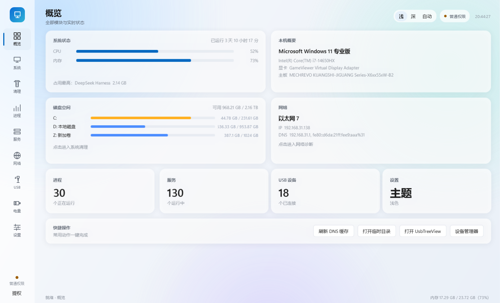
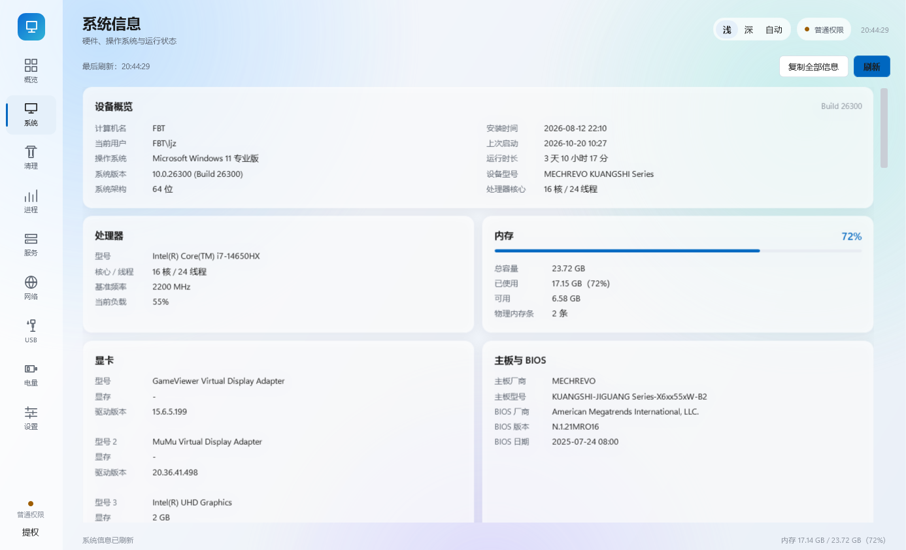
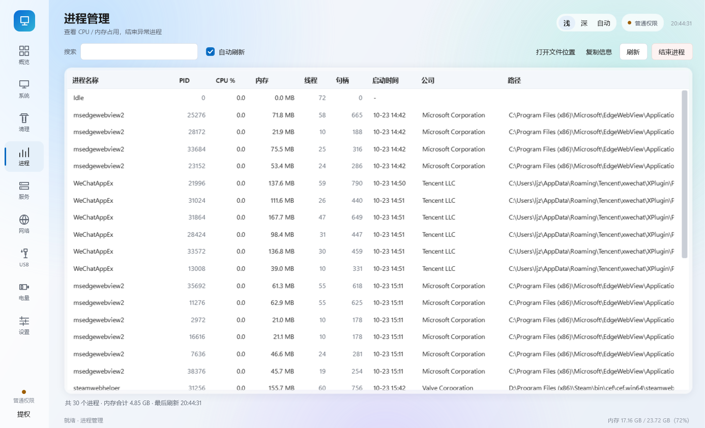
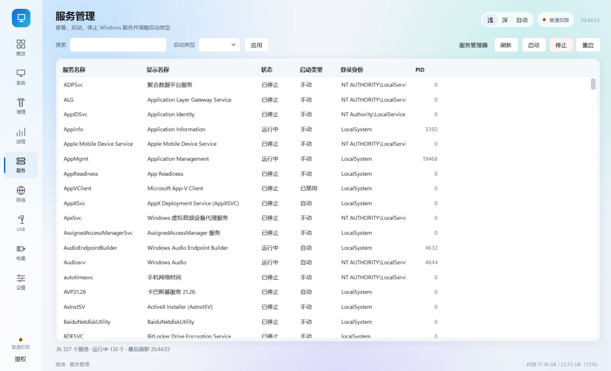
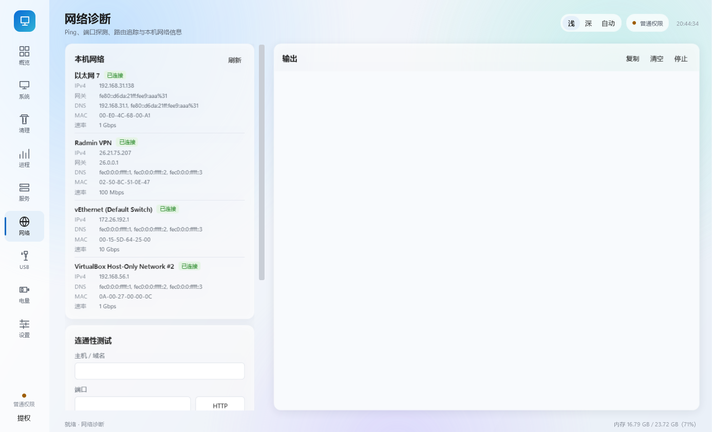
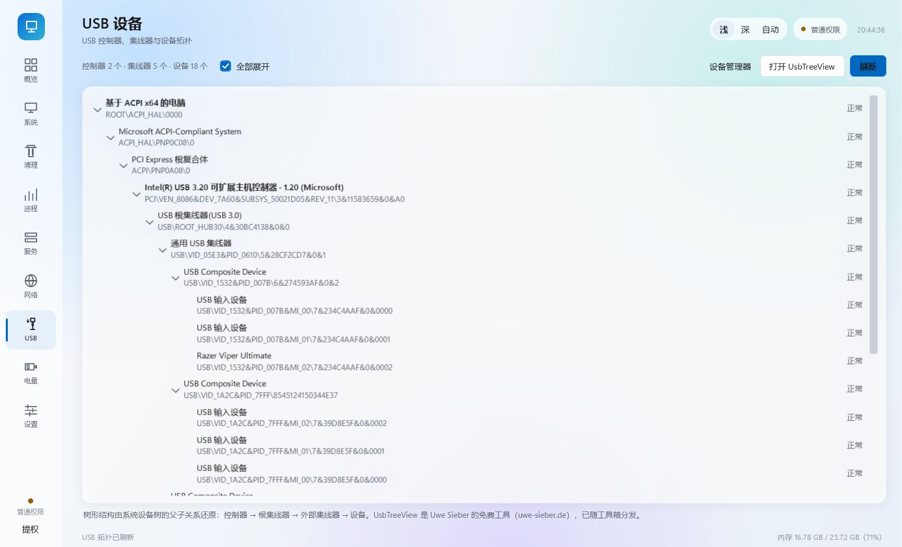
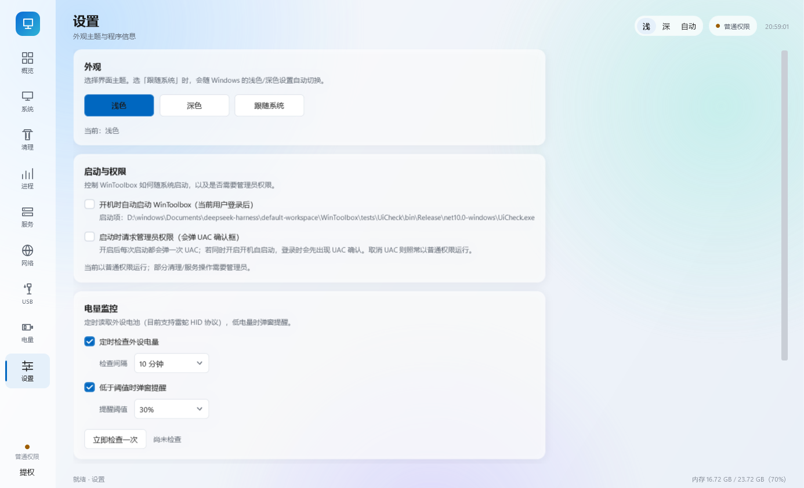
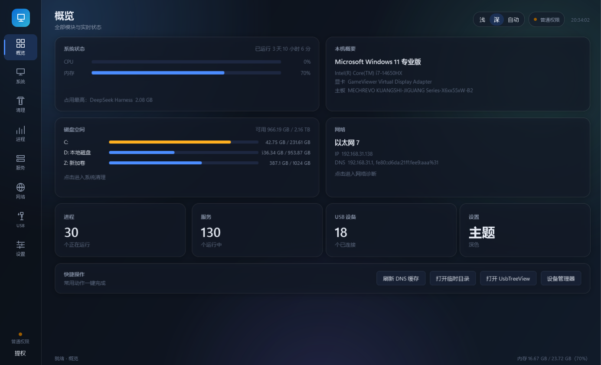

# WinToolbox · Windows 电脑工具箱

> 一个面向 Windows 10 / 11 的原生桌面工具箱：系统信息、垃圾清理、进程与服务管理、网络诊断、USB 拓扑、外设电量、主题与自动化设置，全部装在一个自包含的程序里，**目标机器不需要安装 .NET 运行时**。

[](#)
[](#)
[](#)
[](LICENSE)

<p align="center">
  
</p>

---

## 目录

- [这是什么](#这是什么)
- [功能一览](#功能一览)
- [截图](#截图)
- [系统要求](#系统要求)
- [安装](#安装)
- [快速上手](#快速上手)
- [设置项说明](#设置项说明)
- [技术栈](#技术栈)
- [项目结构](#项目结构)
- [从源码构建](#从源码构建)
- [打包安装包（MSI）](#打包安装包msi)
- [维护与发版](#维护与发版)
- [外设电量是怎么读到的](#外设电量是怎么读到的)
- [已知限制](#已知限制)
- [隐私与安全](#隐私与安全)
- [常见问题](#常见问题)
- [贡献](#贡献)
- [致谢与第三方](#致谢与第三方)
- [许可证](#许可证)

---

## 这是什么

WinToolbox 把日常排查电脑问题要用的十几件小事收进一个界面：看一眼硬件和系统版本、清掉几个 G 的临时文件、找出吃内存的进程、启停服务、测网络、查看 USB 设备树，顺便看一眼无线鼠标还剩多少电。

设计目标三点：

1. **零依赖**：自包含发布，客户机不装 .NET、不装 VC++ 运行库，双击即用。
2. **不骗人**：能读的读，读不到的说清楚原因，不假装成功。
3. **看着舒服**：Windows 11 Fluent 风格，玻璃卡片 + 流动渐变背景，浅色 / 深色 / 跟随系统三档，切换即时生效。

## 功能一览

| 模块 | 能做什么 |
| --- | --- |
| **概览** | 磁贴仪表盘：CPU / 内存占用条、占用最高进程、运行时长、本机概要（系统版本、CPU、显卡、主板）、磁盘分区、网络（IP / DNS）、进程 / 服务 / USB 数量、快捷操作 |
| **系统信息** | 计算机名、当前用户、Windows 版本与构建号、安装/启动时间、运行时长、CPU 型号与核心数、内存容量与插槽、显卡、主板与 BIOS、磁盘与网卡；一键复制全部信息 |
| **系统清理** | 8 类垃圾扫描（临时文件、浏览器缓存、日志、回收站等），可勾选清理；开机启动项管理（禁用而不删除，可恢复） |
| **进程管理** | 实时进程列表（2 秒刷新）、内存占用、结束进程、定位文件 |
| **服务管理** | WMI 读取全部 Windows 服务、启动 / 停止 / 改启动类型（需管理员） |
| **网络诊断** | 本机适配器信息、Ping（走系统 `ping.exe`，兼容中文输出）、DNS 解析、TCP 端口探测、HTTP 访问测试（支持完整 URL）、路由追踪、`ipconfig` / `netstat` / `arp` / 刷新 DNS；输出控制台可复制、可停止 |
| **USB 设备** | 用 CfgMgr32 还原真实设备树：控制器 → 根集线器 → 外部集线器 → 设备；内置随包 UsbTreeView 查看完整描述符 |
| **电量** | 系统电池 + 外设电量（雷蛇 HID 协议，免驱动）；显示百分比、充电状态、读取失败原因 |
| **设置** | 主题三档、开机自启、启动提权、电量定时检查与低电量提醒、程序与配置目录 |

快捷键：`Ctrl+1` ~ `Ctrl+9` 切换页面，`Ctrl+R` 刷新当前页。

## 截图

| 概览（磁贴仪表盘） | 系统信息 |
| --- | --- |
|  |  |

| 系统清理 | 进程管理 |
| --- | --- |
|  |  |

| 服务管理 | 网络诊断 |
| --- | --- |
|  |  |

| USB 拓扑 | 电量 |
| --- | --- |
|  |  |

| 设置 | 深色模式 |
| --- | --- |
|  |  |

## 系统要求

- Windows 10 1809+ / Windows 11，**x64**
- 无需安装 .NET 运行时（发布包自带运行时）
- 部分功能（清理系统目录、启停服务）需要管理员权限，程序内可一键提权重启

## 安装

### 方式一：安装包（推荐）

下载 `WinToolbox-Setup-1.0.0.msi`，双击安装：

- 默认安装到 `%LOCALAPPDATA%\Programs\WinToolbox`（**按用户安装，不需要管理员**）
- 自动创建桌面与开始菜单快捷方式
- 卸载：Windows「设置 → 应用」里找到 **WinToolbox 电脑工具箱**，或执行
  ```bat
  msiexec /x WinToolbox-Setup-1.0.0.msi
  ```

> 想装到 `Program Files`（所有用户可用）：把 `installer/Package.wxs` 里的 `Scope` 改成 `perMachine`，目录换成 `ProgramFiles64Folder`，重新打包即可，安装时会弹 UAC。

### 方式二：便携版

下载 `WinToolbox-1.0.0-portable.zip`，解压到任意目录，双击 `WinToolbox.exe`。整个文件夹就是全部内容，拷到 U 盘也能跑。

## 快速上手

1. 打开默认进入**概览**，磁贴数字每 3 秒刷新，点任意磁贴跳到对应模块。
2. 清垃圾：「清理」→ 勾选项目 → 开始清理。
3. 测网络：「网络」→ 输入域名 / IP → Ping / 端口 / HTTP。
4. 看鼠标电量：「电量」→ 若显示「接收器拒绝查询」，先动一下鼠标再点「刷新电量」。
5. 换皮肤：右上角「浅 / 深 / 自动」，或到「设置 → 外观」。

## 设置项说明

配置文件：`%LOCALAPPDATA%\WinToolbox\settings.ini`（删掉即恢复默认）。

| 设置 | 说明 | 默认 |
| --- | --- | --- |
| 外观主题 | 浅色 / 深色 / 跟随系统（每 3 秒同步系统设置） | 跟随系统 |
| 开机自启动 | 写入 `HKCU\Software\Microsoft\Windows\CurrentVersion\Run`，当前用户登录后启动 | 关 |
| 启动时请求管理员权限 | 开启后每次启动弹一次 UAC；取消则照常以普通权限运行 | 关 |
| 定时检查外设电量 | 后台定时读取，间隔可选 1 / 5 / 10 / 15 / 30 分钟 | 开（5 分钟） |
| 低电量提醒 | 低于阈值时右下角弹窗，点一下跳到电量页；同一设备 30 分钟内不重复提醒 | 开（20%） |

> 「开机静默以管理员运行」需要计划任务（`schtasks /RL HIGHEST`），Windows 不允许普通程序静默提权，欢迎提交 PR。

## 技术栈

- **C# / .NET 10**，WPF（`net10.0-windows`）
- 零第三方 UI 库：样式、控件模板、主题全部在 `Themes/` 里手写
- NuGet 依赖仅 `System.Management`（WMI）
- P/Invoke：`dwmapi`（标题栏配色）、`hid` + `cfgmgr32`（USB 拓扑与电量）、`shell32`（打开目录）、`kernel32`
- 命令行功能（`ping` / `tracert` / `ipconfig` / `sc`）通过 `Shell` 封装，统一 UTF-8 输出

## 项目结构

```
WinToolbox/
├─ App.xaml / App.xaml.cs        # 单实例、主题、自动提权、电量监控启动
├─ MainWindow.xaml(.cs)          # 外壳：图标侧栏 + 玻璃页头 + 页面宿主
├─ Core/
│  ├─ Native.cs                  # DWM、UAC、Shell 打开目录、CfgMgr32 设备树
│  ├─ Shell.cs                   # 进程执行 / 流式输出 / 打开路径
│  ├─ Wmi.cs                     # WMI 查询封装
│  ├─ ThemeManager.cs            # 主题切换与跟随系统
│  ├─ AppSettings.cs             # settings.ini 读写 + 开机自启注册表
│  ├─ Battery.cs                 # HID 枚举 + 雷蛇电量协议 + 系统电池
│  ├─ BatteryMonitor.cs          # 定时检查与低电量事件
│  └─ IAppPage.cs / Format.cs
├─ Models/Models.cs              # 进程 / 服务 / 启动项 / 清理项模型
├─ Views/                        # 九个页面 + Toast 提示窗
├─ Themes/                       # Theme.xaml（样式）+ Palette.Light/Dark
├─ tools/UsbTreeView.exe         # 随包第三方工具
├─ assets/app.ico
├─ installer/                    # WiX 安装包工程
│  ├─ Package.wxs
│  ├─ Components.wxs             # 由脚本生成的文件清单
│  └─ build-installer.ps1
├─ tests/UiCheck/                # 离屏渲染校验 + 网络/电量自检工具
├─ build.ps1                     # 自包含发布
├─ release.ps1                   # 一条命令：改版本 → 发布 → 出 MSI/ZIP
├─ docs/RELEASING.md             # 维护与发版指南（升级、回滚、坑）
└─ README.md / LICENSE / CHANGELOG.md
```

## 从源码构建

前置：Windows 10/11 x64、[.NET SDK 10](https://dotnet.microsoft.com/download)。

```powershell
git clone https://github.com/<your-name>/WinToolbox.git
cd WinToolbox

# 自包含发布（输出到 publish\，约 133 MB，257 个文件）
powershell -ExecutionPolicy Bypass -File build.ps1

# 或直接编译运行
dotnet run
```

发布参数：

| 参数 | 作用 |
| --- | --- |
| 无 | 自包含文件夹（默认，客户机零依赖） |
| `-FrameworkDependent` | 依赖框架的精简包（体积小，需装 .NET 10 Desktop Runtime） |
| `-Configuration Debug` | 调试版 |

## 打包安装包（MSI）

安装包用 [WiX v5](https://wixtoolset.org/) 生成，脚本全在仓库里：

```powershell
# 1) 先发布
powershell -ExecutionPolicy Bypass -File build.ps1

# 2) 安装 WiX（一次性，装在用户目录，不需要管理员）
dotnet tool install --global wix --version 5.0.2
wix extension add -g WixToolset.UI.wixext/5.0.2

# 3) 生成文件清单并打包
powershell -ExecutionPolicy Bypass -File installer/build-installer.ps1
# 产物：dist\WinToolbox-1.0.0.msi
```

`build-installer.ps1` 会扫描 `publish/`，重新生成 `installer/Components.wxs`（每个文件一个 Component），再调用 `wix build`。

> 打包前请把 `installer/Package.wxs` 里的 `ARPHELPLINK` 换成你的仓库地址；`UpgradeCode` 发版后不要再改，否则升级会变成并存安装。

## 外设电量是怎么读到的

这部分大概是本项目最有意思的地方（也方便你给别的品牌加支持）：

1. 用 SetupAPI 枚举所有 HID 接口，找到雷蛇（VID `0x1532`）带 **91 字节 Feature Report** 的控制接口。
2. 组一个 **90 字节报文**：
   ```
   [0]=status  [1]=transactionId  [2..3]=remaining  [4]=protocolType
   [5]=dataSize  [6]=commandClass  [7]=commandId  [8..]=arguments
   ```
3. **关键**：`[88] = XOR(报文[2..87])`。少了这个校验字节，设备会直接回 `status=0x03`（失败）。
4. 用 `HidD_SetFeature`（91 字节缓冲，首字节为 report id `0x00`）发送，`HidD_GetFeature` 读取回包：
   - `status == 0x02` 表示成功
   - 电量原始值在 `frame[9]`（0~255），换算 `round(raw * 100 / 255)`
   - `frame[10]` 表示是否在充电
5. 设备休眠时会返回失败，代码里带 8 次重试，并提示「动一下鼠标再刷新」。

协议细节参考了开源社区实现（OpenRazer、[ClickSync](https://nuitfanee.github.io/ClickSync.github.io/) 的 WebHID 版本）。

## 已知限制

- **电量**：目前只实现雷蛇协议。罗技（HID++）、赛睿、华硕等品牌协议不同，尚未支持；有线鼠标/键盘通常没有电池。
- **网络诊断**：部分环境（公司网络、安全软件）会拦截 ICMP，Ping / tracert 会失败并给出提示，属正常现象；建议改用 TCP 端口或 HTTP 测试。
- **清理**：为避免误删，只扫描常见临时/缓存目录，跳过符号链接与正在占用的文件。
- **管理员相关**：清理系统目录、启停服务需要管理员权限，界面会提示，不会静默失败。
- **仅 Windows x64**：ARM64 与 32 位系统未测试。

## 隐私与安全

- **不联网**：没有任何遥测或上报；唯一的网络行为是你在「网络诊断」页主动发起的测试。
- **本地读取**：系统信息来自 WMI，电量来自本机 HID 设备，设置只写 `%LOCALAPPDATA%` 与 `HKCU`。
- **提权可控**：默认普通权限运行；只有你在设置里开启「启动时请求管理员权限」才会弹 UAC。
- **不自动改系统**：服务启停、清理、启动项禁用都需要你手动点击。

## 常见问题

**Q：安装包 47 MB，装完 133 MB？**
A：安装包用 CAB 压缩，且包含完整 .NET 运行时；解开后是 257 个文件的自包含程序。

**Q：Windows Defender 提示未知发布者？**
A：安装包没有代码签名证书。可以点「更多信息 → 仍要运行」，或用源码自行编译。

**Q：鼠标电量一直「接收器拒绝查询」？**
A：多数是鼠标休眠，动一下鼠标再点「刷新电量」；仍失败可能是该型号接收器不开放查询（欢迎提 issue 附型号）。

**Q：打开目录没反应？**
A：程序用 Shell API（`SHOpenFolderAndSelectItems`）打开目录，不启动新的 `explorer.exe`，避免部分环境的 0x142 崩溃。若仍无反应，检查是否被安全软件拦截。

**Q：能做成单文件 exe 吗？**
A：已尝试，本机环境下 `PublishSingleFile` 发布后静默退出，因此默认用文件夹发布 + MSI 安装包。

## 维护与发版

日常改完代码，一条命令出安装包：

```powershell
powershell -ExecutionPolicy Bypass -File release.ps1 -Version 1.1.0
```

它会依次：改 `WinToolbox.csproj` 版本号 → 自包含发布 → 生成 `dist\WinToolbox-Setup-1.1.0.msi` 与 `WinToolbox-1.1.0-portable.zip`。

发 Release（CI 会自动构建并附上产物）：

```powershell
git add -A
git commit -m "chore: release v1.1.0"
git tag v1.1.0
git push; git push --tags
```

**升级必须遵守的三条**（否则老用户升不上来）：

1. `installer/Package.wxs` 里的 `UpgradeCode` **永远不要改**（改了会并存安装）；
2. 新版本号必须比旧版本大；
3. 不要改安装目录与产品名。

完整流程、检查清单与常见问题见 [docs/RELEASING.md](docs/RELEASING.md)。

## 贡献

欢迎 PR / issue：

1. Fork 并新建分支：`git checkout -b feature/xxx`
2. 保持代码风格与现有文件一致（一个模块一个文件，`Core/` 不引用 `Views/`）
3. 提交前跑 `dotnet build -c Release`，确保 0 warning / 0 error
4. PR 描述写清「改了什么、为什么、怎么验证」

详细约定见 [CONTRIBUTING.md](CONTRIBUTING.md)。

## 致谢与第三方

- **[UsbTreeView](https://www.uwe-sieber.de/usbtreeview_e.html)** — Uwe Sieber 的免费 USB 查看器，随包分发，版权归原作者。
- **[OpenRazer](https://github.com/openrazer/openrazer)** — 雷蛇 HID 协议的社区文档来源。
- **[ClickSync](https://nuitfanee.github.io/ClickSync.github.io/)** — 网页版鼠标驱动，报文格式与校验和参考。
- 其余代码、样式、图标均为本仓库原创。

## 许可证

本项目采用 [MIT License](LICENSE)。第三方工具 `tools/UsbTreeView.exe` 版权归 Uwe Sieber，遵循其原始授权（免费软件），分发时请保留出处。

---

<details>
<summary>English summary</summary>

**WinToolbox** is a native Windows 10/11 toolbox built with C#/.NET 10 + WPF. It bundles system information, disk cleanup, process/service management, network diagnostics, USB topology, and wireless peripheral battery reading (Razer HID protocol) into one self-contained app with a Fluent/Mica-inspired UI (light, dark, or system).

- **No runtime required** on target machines (self-contained publish).
- **Installer**: per-user MSI (no admin needed) or portable ZIP.
- **No telemetry**, no network calls except user-initiated diagnostics.

Build: `powershell -File build.ps1` → `publish/`. Installer: [installer/build-installer.ps1](installer/build-installer.ps1).

License: MIT (third-party UsbTreeView belongs to Uwe Sieber).

</details>
